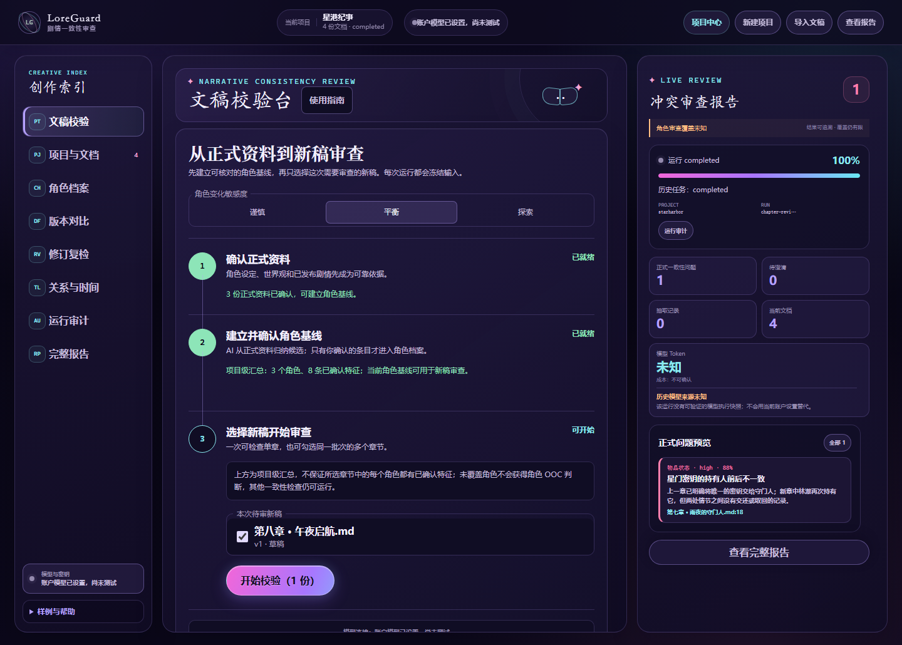
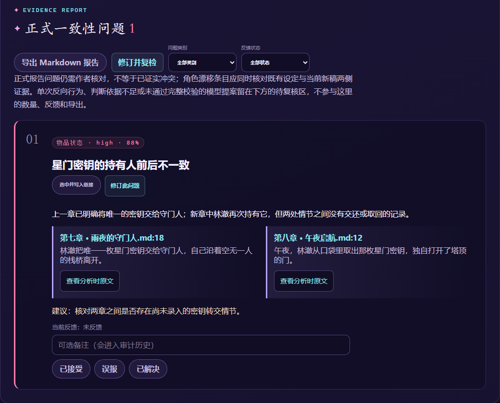

<div align="center">

# LoreGuard

### 故事不断生长，设定始终有迹可循。

面向小说作者与游戏剧情策划的 AI 辅助故事剧情一致性审查平台。

**简体中文** · [English](README.md)

[](docs/current-stage-status.md) [](LICENSE) [](https://github.com/print636/LoreGuard/actions/workflows/ci.yml)

[浏览界面](#走进-loreguard) · [快速开始](#快速开始) · [文档中心](docs/README.md) · [反馈问题](https://github.com/print636/LoreGuard/issues)

</div>



<p align="center"><sub>实际应用界面，使用原创演示数据；截图用于展示工作流程，不代表模型质量评测成绩。</sub></p>

## 写到新章节，也能记得旧故事

LoreGuard 将世界观设定、角色档案、已发布历史与新稿放进同一套审查流程，帮助你查找潜在矛盾，并追溯到分析时使用的原文版本。它提供依据，把最终判断留给作者。

可以在写作过程中检查单章，也可以在一批剧情完成后集中审查。没有提前整理好世界观？只提供正文，也能从有限的新稿自检开始。

## 走进 LoreGuard

### 把资料、审查与作者的判断连起来

| 你想做的事 | LoreGuard 提供的能力 |
| --- | --- |
| 整理已有创作 | 导入 Markdown、TXT、JSON、DOCX；管理文稿并阅读历史版本。 |
| 用正确的背景审查新稿 | 选择章节，以作者确认的设定与已发布历史作为依据；也可仅审查新稿，并明确提示覆盖边界。 |
| 发现前后不一致 | 检查事实、地点、时间线、角色知识、物品持有和世界规则；结合确定性检查与可选的模型辅助抽取。 |
| 看清为什么被指出 | 对照两侧原文证据，打开分析时冻结的正文；正式问题、待复核线索和未核实提案分别展示。 |
| 辅助核对角色表现 | 作者确认角色特征后，对照新稿中的行为。此项为**需配置开启的实验性能力**，不承诺成熟的 OOC 判断质量。 |
| 自己决定如何处理 | 反馈、修订复检、导出 Markdown 报告；章节只有经作者手动发布，才进入后续历史。 |

### 不只告诉你“有问题”，也让你看到依据



每条潜在冲突都应说明原因、提供来源。材料不足或一次不同表现可留在待复核线索中，不会因为模型给了建议，就自动算作正式矛盾。

<details>
<summary>看看不确定的角色表现如何留在待复核区</summary>


这条线索仍需作者判断，不计入正式问题数量或报告导出。图中的角色审查流程属于需配置开启的实验性能力。

</details>

<details>
<summary>还有哪些围绕审阅工作的工具？</summary>

- 文稿版本比较与历史分析记录。
- 可按需选择的关系图与时间线。
- 持久化任务进度、取消及受控重试。
- 账户模式下的个人项目与自带模型配置。
- 产品内使用指南，以及指定编辑区域的草稿恢复。

各项能力有不同的使用边界，详见[使用与开发参考](docs/developer-guide.zh-CN.md)。

</details>

## 从一份新稿，到可以复核的报告

1. **导入与确认。** 整理设定、历史剧情与新稿，确认哪些资料是正式依据。
2. **选择与审查。** 勾选本次章节或批次；需要 AI 辅助时，先配置自己的模型。
3. **核对与处理。** 阅读问题和线索的证据、留下反馈、修订后复检；是否定稿发布，由你决定。

## 快速开始

### Windows · 本地体验

先安装 **Python 3.12**、**Node.js 22**，并确保 **pnpm 或 Corepack** 可用。

```powershell
git clone https://github.com/print636/LoreGuard.git
cd LoreGuard
.\启动LoreGuard.cmd
```

也可以直接双击项目根目录的 `启动LoreGuard.cmd`。启动器会安装依赖、按需构建网页，并打开 [http://127.0.0.1:8000](http://127.0.0.1:8000)。建议先运行内置原创样例熟悉流程。

### Docker Compose

安装 Docker 与 Compose 后，在仓库根目录运行：

```bash
docker compose up --build
```

打开 [http://localhost:8080](http://localhost:8080)。

> 确定性样例无需 API Key；AI 辅助分析需要模型配置。角色审查、向量检索和工具调用实验并非默认全部开启，详见[配置与能力开关](docs/developer-guide.zh-CN.md)及[账户模型配置](docs/account-model-provider.md)。本地匿名体验配置不能直接作为公网安全部署方案。

## 文档导航

| 我想了解… | 阅读入口 |
| --- | --- |
| 产品流程与使用方法 | [文档中心](docs/README.md) · [产品内指南说明](docs/product-help-v1.md) |
| 模型配置与可选能力 | [使用与开发参考](docs/developer-guide.zh-CN.md) · [个人模型与密钥](docs/account-model-provider.md) |
| 项目如何实现 | [系统架构](docs/architecture.md) · [证据检索](docs/evidence-retrieval-v1.md) |
| 如何部署与维护 | [生产部署](docs/production-deployment.md) · [备份恢复](docs/backup-restore-rehearsal.md) |
| 当前进度与评测边界 | [阶段状态](docs/current-stage-status.md) · [人工封闭评测协议](docs/character-ooc-closed-evaluation-v1.md) |
| 外部参考与原创边界 | [ConStory-Bench 使用边界](docs/constory-bench-boundary.md) |

原首页中的参数、实现细节、评测口径及故障处理说明，已保留在[中文技术参考](docs/developer-guide.zh-CN.md)与[英文技术参考](docs/developer-guide.en.md)。

## 当前边界

LoreGuard 处于 **Preview** 阶段，辅助审阅而不替代作者判断。开放文本质量仍待独立人工评测；运行完成或零问题，不等于整部故事已被完整理解和验证。角色一致性与工具调用等实验能力需要显式配置。

请只使用你拥有权利或获得授权的文本。本项目不连接或控制商业游戏。

## 参与改进

欢迎通过 [Issues](https://github.com/print636/LoreGuard/issues) 提交可复现的问题、使用反馈或流程建议。请先移除私人稿件、密钥和个人信息；代码改动请说明预期行为并补充相关测试。

## 开源许可

[Apache License 2.0](LICENSE)。
