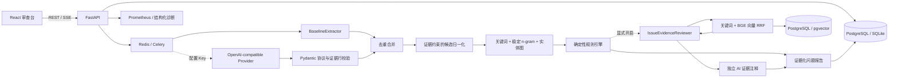

# 架构与关键权衡

- 基础状态与后续扩展关系统一保存为带 `kind/attrs/evidence` 的通用 JSON 记录，并按已完成运行投影关系图和时间线；尚未建立规范化的实体表、关系表或图数据库。这样保持本地部署简单，也避免把检索相似度误当成已成立的剧情关系。
- 基础事实路径由模型抽取有来源的状态和关系，再由规则比较。角色深度审查另有证据约束的模型判断。未配置 Key 时仍可运行有限的确定性预检，不能把它描述为完整理解普通故事。
- 模型结果使用 Pydantic 判别联合验证，并由服务端根据 `source_line_start/end` 回填原文，不接受模型自己编造的证据正文。
- 模型增强按配置字符上限切为带原文全局行号的 `DocumentChunk`；行 overlap 记录按全局证据区间去重。单块失败只降级该块，超过上限明确 warning，而全文 baseline 始终执行。
- 顶层 envelope 严格限制为 `records`，数组内逐条隔离校验；单条错误只被跳过并记录安全警告，全部无效时才整体降级。
- Provider 对超时、429、5xx、空响应和非法 JSON 执行有限指数退避；字段非法或证据越界同样降级。默认 2 次 × 30 秒；一个分块终态失败即停止当前文档剩余模型分块，一个文档出现终态失败后打开本次运行熔断，后续文档直接使用全文基线。错误消息不包含 Key 或响应正文。
- 模型与基线通过规范化的类型、字段和证据区间去重；一次分析的最终记录持久化，展示层不会触发二次模型费用。
- 项目级 alias map 只读取明确“又名/简称/化名/代号”声明。归一化只改结构化实体字段，不改证据正文；循环或一名多主保留原名并警告。
- 本地候选排序继续使用关键词、SHA-256 稳定桶字符 n-gram 余弦和共享 canonical entity graph 三分。`CandidatePair.consumed` 仅表示类型兼容，确定性裁决仍调用全量 `detect_issues`；这条主路没有被向量相似度替代。
- Evidence RAG 是与确定性裁决解耦、默认关闭的后置通路：独立显式配置的 OpenAI-compatible embedding client、中文确定性行号分块、版本化 embedding profile，以及按项目、文档、版本、内容哈希和 chunker 精确隔离的 chunk/vector schema；PostgreSQL 使用真实 `vector` 列并执行精确余弦搜索，关键词与 dense 候选通过 RRF 合并。真实固定 BGE embedding、索引复用、pgvector 检索和隔离负例均已运行。
- `IssueEvidenceReviewer` 在规则引擎已经产生 issue 后才工作。它从本次运行冻结快照中检索获授权证据，用服务端签发的引用标签调用同一结构化模型合同，并把 `supports_issue`、`contextual_exception` 或 `insufficient_evidence` 保存到 issue 的 `metadata.ai_evidence_review`。它不会删除、改写 issue 的类别、严重度、证据或建议；检索、模型或校验失败时保留原规则报告并记录降级诊断。
- 修订复检使用独立 lineage：`retry` 继续重用原冻结输入，`recheck` 冻结项目当前活动版本。目标任务完成并落下最终 diagnostics 后，`issue-match-v1` 才持久化 `no_longer_detected`、`persisting`、`new` 或 `unverifiable`。匹配只接受唯一的一对一规则身份/证据签名；降级、歧义和不可比输入均 fail-closed。完整契约见 [修订—复检闭环 V1](revision-recheck-v1.md)。
- Evidence Reviewer 由 `ENABLE_ISSUE_EVIDENCE_REVIEW` 显式开启，默认 `false`；默认还要求真正的 hybrid 检索。Key、endpoint、Prompt、原文和模型原始响应不进入持久化注释或公开评测报告。
- 模型/基线合并后还有一层不调用模型的候选归一化：把“取出工具并执行操作”映射为 `uses`，把范围内能力禁用规则和实际发动行为映射为共享 canonical key。该层只依据服务端原文证据生成状态，仍由规则引擎比较两侧证据后产生 issue。
- 基线对带“日志显示/记录记载”等报告前缀的显式时间—人物—地点句单独解析，报告来源不会再被并入人物名；地点在会面、检查等动作前保守截断。
- 持续身体状态使用 `body_state:<方向><部位族>` canonical key 对齐“失去肢体”与“完好同侧末端”，恢复、幻象和伪装措辞不进入该冲突候选。
- 移动许可使用 `fact/mobility_permission` 保存 actor、起终点/双向范围、状态和有效期；只有与冲突角色、地点对和事件时间全部匹配才抑制同刻异地。
- 信件、目击、告知、阅读和公告等明确来源统一为带来源类型和时间的 `knows`；规则例外使用 `fact/rule_exception` 绑定 actor、canonical rule key 与有效状态，`world_assert` 保留 actor。
- 普通 fact 若两侧都有不同明确时间，按状态迁移处理；持续无时间事实仍按原规则比较，避免恢复场景退化。
- `item`/`uses` 在规则检查前按实体、角色和证据区间去重；新来源证明及不同物品状态保留，不能把交接与占有观察合并掉。旧无证明记录沿用可选时间措辞归一化；最终 issue 再按类别、canonical metadata 与证据对去重。
- SSE 比 WebSocket 更适合单向进度流；事件持久化并同时接受 `Last-Event-ID` 请求头和 `last_event_id` 查询参数。终态事件携带 `status/error`，因此断线恢复后不会把失败误判为完成。
- 分析启动与重试可使用项目级 `Idempotency-Key`。数据库唯一索引负责并发裁决，接口再核对“普通启动”或“来自指定旧运行的重试”语义；同键不同语义固定返回 `409`。只有创建胜者投递任务，调度异常会把仍为 `queued` 的运行转为带安全终态事件的 `failed`。当前没有事务型 outbox，因此不宣称消息或模型调用 exactly-once。
- `/metrics` 的运行数、持久化终态事件与终态耗时在抓取时从共享数据库派生，而不是依赖 API/worker 各自的内存 Counter。状态标签使用固定集合，缺少合法起止时间的终态运行单独计数；数据库不可读时返回 503，不输出伪造的零值。详细语义见 [`observability.md`](observability.md)。
- 在线执行默认线程模式以降低本地门槛；Compose 预置 Celery worker，生产部署可切换为队列。
- 同名文档停用旧活动版本并创建递增版本；运行始终读取活动版本。项目、文档历史、运行历史与反馈审计是独立查询边界，前端刷新不依赖内存状态。
- 版本差异使用 Python `SequenceMatcher` 在服务端做确定性的行级比较，只允许同一项目、同名文件的两个不同版本。响应提供版本元数据、增删/未变行统计和带上下文的 hunk，不进入抽取管线或 Provider。为限制内存与页面体积，默认每个版本比较前 20,000 行/2,000,000 字符、最多输出 4,000 行；截断范围与摘要口径会显式返回 warning。
- 取消请求幂等，但终态任务返回 `409`；重试只接受 `failed/cancelled` 任务，并通过同一调度入口尊重 `USE_CELERY`。
- 所有问题必须附 `EvidenceSpan`；无证据的模型输出不得进入最终问题列表。
- 模型逐块前执行单次 Token 预算门控；Provider 不返回 usage 时按本地保守估算计入门控。每日额度和滑动窗口限流当前只保证本地单实例行为，多实例部署必须替换为 Redis/事务式原子配额。
- 成本只有在输入、输出单价均配置时才计算；未配置价格与真实零成本在 API 中严格区分。
- 关系图与时间线只读取某次已完成运行持久化的状态记录，不调用 Provider。图使用类型命名空间稳定节点 ID，每条边保留记录 ID、证据与关联问题；相对/无时间记录进入“时间未确定”区，不做虚假排序。当前响应限制为 500 节点/1000 边，超限显式返回 warning。

## 普通叙事中的时间与知识约束

同一条主线或相同的钟点不自动表示同一天。普通抽取可以在同一批请求中提交有来源的时间关系，说明两个已提供时间点的同日、同刻或先后关系。服务端核对时间点、冻结文档范围和关系依据；规则只在关系明确且不存在冲突时比较，不为缺失年月日的故事生成虚构日期。当前只处理有界直接关系，不做无限传递推理或跨未提供材料的时间图补全。

知情状态与实际获知事件分开记录。“在某时之前明确不知道”“截至某时仍不知道”与“到某时已经表现出知情”可以参与比较，但不能改写为该时刻发生过一次获知。新策略也不把后来一次普通阅读或听说记录当作最早可能知情时间。没有读取某份文件、没有听某人讲述或文件未拆封，单独都不能证明不存在其他合理来源；推断必须受正文已有依据约束，不能强行认定全局不知情，也不能凭空编造另一种获知方式来否定所有冲突。

同日身份、知识约束及当前表现的依据都加入最终问题的原文证据。未提供关系、存在歧义或范围无法确认时，保留未完成判断的边界，不用两个相同钟点制造冲突。新能力由服务器为普通新任务冻结，不增加作者开关、不依赖角色深度审查；旧任务重试沿用旧抽取和比较方式。持久化继续复用现有记录与多证据阅读接口。

## 有来源的叙事时间范围

普通抽取在原调用中可输出有界的时间范围，明确哪些原文事件属于同一天、具有实际发生顺序，或同时具备这两种关系。模型结合完整上下文理解关系与钟点含义；服务端定位逐字依据，核对冻结来源、范围成员与最终接纳的事件。来源绑定成功只证明可追溯，不保证模型对叙事的理解必然正确。

原时间短语和标准钟点分别保存。例如正文可以保留“当天九点半”或“随后”，有依据时再给可比较钟点；未知时不补日期或时刻。顺序指事件发生先后，不能直接用文本排列替代。同日也不自动代表列表从早到晚，更不能用同一个钟点证明同一天。相互矛盾的关系保留未知，不挑选有利的一条来制造结论。

批量提示明确区分两层边界：原子证据分别归属对应文档，有来源的时间关系可以引用本次授权、故事作用域兼容的多份文档。相互隔离的证据分组不意味着禁止跨稿理解；输出仍需说明实际成员覆盖或不确定，不能自动补上没有依据的关系。模型已为事件指定原时间时，服务端优先在事件片段内定位，再允许同一冻结完整证据范围内唯一的时间来源，支持前半句时间适用于后半句的普通表达；这不授权跨来源取时间，也不提高模型的确定程度。

每个范围只作用于列明且有来源的有限成员，不自动扩大到整章，也不通过多个范围拼接出无限传递关系。成员引用同一行多个事件时仍需指明对应的实际事件；同一行动的持有与使用可以引用同一时间依据，但独立行动和不同状态不能因此混同。当前基线记录没有独立动作位置，不能仅凭整段引用相同认定它是模型记录的副本；本轮保留这些记录及其未决，没有扩展自然文本去重。

范围有来源、成员匹配到接纳记录、事件实际参与比较是三件不同的事。私有核验记录保留这些对应关系，未接纳成员不会被伪装成已完成判断；缺失、遗漏或不明确的范围仍须反映覆盖边界。公开界面沿用现有记录和完整原文入口，使用“时间范围”等中文说明，不展示私有成员编号。普通新运行冻结策略，旧重试沿用原义；本轮实现与实测状态见[当前阶段记录](current-stage-status.md)。

## 同段落中的行为与解释

角色解释复核保留完整来源上下文，同时区分当前行为与解释事实的具体片段。句号、分号等只帮助提供定位，同一句内不同的语义断言也可分别指认；片段可以共享角色或依靠上下文承接，不要求重复相同词语。服务端检查冻结文档、原文位置、目标绑定及片段范围，模型负责判断它们在语义上是否独立，以及解释事实的真实性、先后关系和适用性。

来源位置不同只是必要条件，不能自动证明因果。解释还须说明当前表现与已确认设定的关系，仅能解释动作原因并不一定能消除设定冲突：反向特征本身不能被换个说法用作豁免。行为本身、目的或尚未得到依据支持的说法不能自动成为解释；有上下文依据的角色自述仍可被合理使用。原文缺失、片段无法区分、语义不明确或既有覆盖不足时，保留可能解释或未决状态，不因换行或分割引用而关闭缺口。

这条能力复用既有的一次解释复核、调用预算和完整原文阅读器。只有服务器冻结了新策略的角色深度审查任务使用新协议，旧任务重试与旧记录沿用原义。内部片段编号、绑定与摘要只用于来源核验，不进入普通报告；运行诊断记录实际采用的协议版本。

## 普通命题来源与物品状态

普通事实、物品状态和物品使用复用既有抽取调用。模型说明原文支持什么命题、各角色或对象如何对应、关系是否实际成立；服务端将所选原文绑定到当前冻结来源。允许同义表达及有依据的省略承接，归纳出的属性名不必逐字出现在正文中。新的来源绑定用于替代相关固定表达限制，不取消否定、假设、未经核实的转述及来源范围检查。结构与引文绑定成功，不等于模型语义理解必然正确。

角色和物件引用优先在所选唯一命题中定位，必要时再使用完整证据中的唯一上下文；同一行另有一次同名不应机械阻断当前命题，仍有歧义时也不能任取第一个位置。格式说明须与解析类型一致，不自动填补模型未给的语义。已知的单条来源绑定失败只隔离该记录并标部分覆盖，其他合法记录保留；未知异常或来源归属错误仍使批次失败。

物品的实际占有、保管状态、交接事件和明确未交接约束分别参与比较。拿出或使用物品可以支持实际占有，却不能自行证明发生了交接；有来源和适用时序的交接可以更新保管状态，不能仅取时间较晚的占有记录覆盖旧约束。未描写交接不等于明确没有交接，物理保管也不是法律所有权。持续或有界约束依据正文与已有直接时间关系确定，不补造日期；对象或适用范围不清时保留未完成判断。

新普通运行由服务器冻结该策略，旧运行重试保持原行为。私有来源核验随运行保存，普通界面继续展示完整证据与可读的状态说明，不展示内部摘要或编号。现有结构化 `@item` 的显式持续设定与自然叙述中的一次观察分别解释，不为维持问题数量把两者混同。本阶段实现及实测进度见[当前阶段记录](current-stage-status.md)。

直接时间关系仍只绑定指定事件，新时间范围也只覆盖其有源成员。固定交接稿已通过跨稿范围完成实际状态比较；综合事实稿仍部分覆盖，不能由局部成功推断所有时序已解决，也不能仅凭记录保存成功宣称状态检查完整。来源绑定、模型确定程度与最终比较结果保持区分。

## 当前扩展边界

`NarrativeExtractor`、`ConsistencyChecker`、Embedding Provider、Evidence Retriever 与 Chat Provider 是独立边界。当前已经形成“规则 issue → 授权快照检索 → 模型证据复核 → 独立注释”的真实消费闭环，但没有把概率模型变成事实裁决者。首次冻结 retrieval holdout 的混合 Recall@5 为 81.82%、All-evidence@5 为 71.43%、低词面 Recall@5 为 79.31%，最后一项差 1 条未过门槛；12 例 Evidence Reviewer A/B 从 4/12 提升至 7/12，但绝对 gate 失败且 `insufficient_evidence` 为 0/4。隐含实体消歧、查询分解、跨块摘要、置信度校准、真实长文人工盲测和生产高并发仍是明确边界，不作为当前继续扩功能的理由。

## 工作台布局与情境说明 V2

故事工作台阶段重组现有平台导航、作品资料阅读和审查报告。目录与原文、选中问题与冻结证据共享当前任务上下文；复用既有账户授权、文档预览、反馈和复检接口，不增加第二份正文存储或全局统计模型。当前资料阅读与分析时冻结原文仍是不同入口，改版不能用当前文稿替换旧报告的依据。

角色深审的新任务冻结 `habit-scope-review-v2`。新能力替换原有最多一次片段情境说明核实：从有界原文窗口判断主体、真实动作、受事、用途和每个已确认情境的关系，服务端定位引文并验证来源与数量。仅各必要条件明确且全部确认情境均不适用时生成现有 `habit_scope_refs_v1` 说明；它不产生反向观察、正式问题或旧材料补全凭据，也不把全文覆盖改为完整。

相邻上下文可供语义判断，当前可显示引用仍须定位于同一原文行；不能由窗口未选中或无返回推出全文无问题。新策略复用原总预算、共享期限及一次尝试，按实际输出预留做预算准入；旧v1重试保持原合同，无字段旧任务不自动升级。私有策略字段由服务端冻结，客户端不能注入；公开接口与原文reader合同不变。详见[引擎合同](story-workbench-engine-v1.md)。

缺口恢复检查按实际来源、确认目标和协议凭据运行。没有相关凭据时直接保留未决，不能将普通目标强行构造成更窄协议的对象。存在真实绑定时仍须核对同目标所有未完成材料；一份有凭据不能遮蔽另一份空观察或未知缺口。完整枚举且确无剩余缺口的包不制造历史残债。该修复不放宽原DTO对象要求、不补造作者未确认的对象或批准轴，也不将程序执行恢复等同于语义审查完整。

## 资料变化提示与复检选材一致性

单个授权运行的 material-impact 只读接口对照分析时冻结资料、当前确定版本链及实际证据引用，分别返回资料明细和直接引用结果的分页。它不创建依赖数据库、不运行模型、不扫描所有故事语义；缺失、无法核实和未纳入资料各自保留。来源身份须沿冻结来源定位，不因同名而把无关结果混为直接引用。

GET 提示与现有复检 POST 复用选材及签名构造，避免客户端只按 ID／版本比较漏掉同版本资料身份变化。只读材料准入不代替提交时的授权、费用、模型和并发检查。新稿由作者主动发起复检，旧运行的快照、人工反馈和已确认角色特征继续保留。

资料变化提醒与正式问题、待复核线索分别显示计数。确定版本与引用关系不能证明全部语义影响；同内容新版本也不能自动推导冲突或修复。此阶段不支持模糊改名、自动拆并章和后台付费重算。当前验证结果见[阶段记录](material-change-impact-v1.md)。

## 单次审查中的物品历程派生视图

物品查询只读取授权运行的已有记录、冻结输入以及持久化的语义／时间范围证明。服务端重验来源、记录和成员对应关系，将物理持有、保管、实际交接、持续约束与使用分别呈现，不建立第二份物品事实库，也不在查询时调用模型。名称与故事范围用于检索分组，不证明所有同名事件必然属于同一实物。

查询返回逐记录来源、可证的事件先后和有界末端摘要。候选须有据不早于其他相关事件，但较早事件彼此未决可继续保留；不要求先编出完整全序。无法核实的相关时间关系按受影响事件对保留屏障，无关范围或确实不同的端点不扩大为全局失败。文字不同本身不能证明时点不同；旧未持久化的直接时间关系只能用于提示可能相关缺口，不补认证其顺序。缺来源、缺语义证明和处理截断继续限制末端判断。

原文阅读器的 `record` 来源沿相同运行授权与冻结哈希、版本、行号合同读取。普通记录和时间范围也可阅读，无需捏造正式问题；当前新版文稿不能替换旧依据。上阶段 material-impact 可提示来源更新并进入作者主动复检，查询不改正式报告或作者确认。

目录扫描、单物品记录、时间范围与页面都有上限；截断和完整性分开表达。该视图不是跨报告状态库、任意章节截止推演或对象同一性引擎。实现与实际验证见[物品查询阶段](item-journey-v1.md)。
